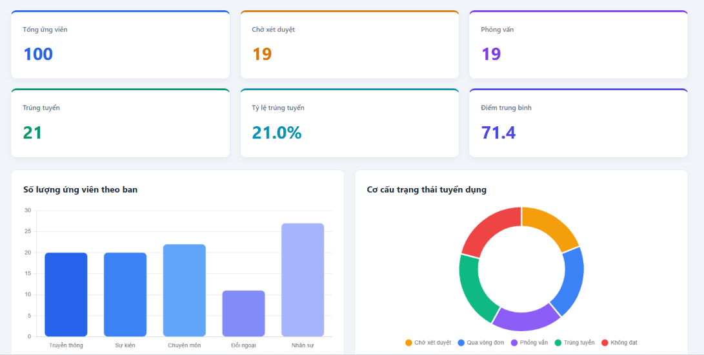
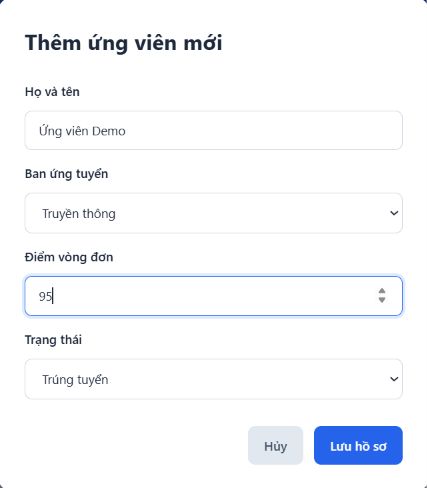
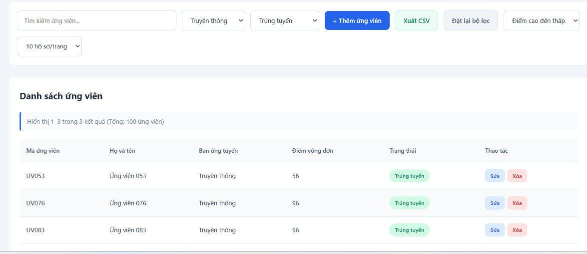
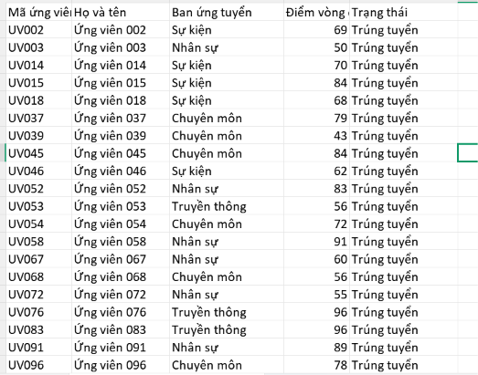

# Smart Recruitment Tracker

A recruitment management and data visualization
web application designed for university clubs
and student organizations.

## 1. Project Overview

Smart Recruitment Tracker is a front-end prototype
that aims to simplify student recruitment by
centralizing applicant information, tracking
recruitment status, and providing automated
statistical reports.

The application uses 100 synthetic applicant
profiles to simulate a recruitment process.

## 2. Project Objectives

- Simplify applicant information management.
- Automate recruitment statistics.
- Improve data accessibility and organization.
- Apply front-end development fundamentals.
- Develop practical problem-solving skills.

## 3. Key Features

### Applicant Management

- Create, read, update, and delete applicants.
- Automatically generate mock applicant data.
- Validate applicant information.
- Assign unique applicant IDs.

### Search and Data Management

- Real-time applicant search.
- Vietnamese accent-insensitive search.
- Filter applicants by department and status.
- Sort applicants by score and name.
- Display applicants using pagination.

### Recruitment Analytics

- Total number of applicants.
- Number of pending applications.
- Number of interview candidates.
- Number of accepted applicants.
- Acceptance rate.
- Average application score.
- Department distribution chart.
- Recruitment status doughnut chart.
- Estimated recruitment funnel.

### Data Storage and Export

- Persistent browser storage using LocalStorage.
- Automatic data saving after CRUD operations.
- CSV export based on selected filters.
- UTF-8 support for Vietnamese text.

### User Interface

- Responsive dashboard.
- Interactive data visualization.
- Recruitment status indicators.
- Applicant management forms.

## Product Screenshots

The following screenshots demonstrate the core
features of Smart Recruitment Tracker using
synthetic applicant data.

### 1. Recruitment Analytics Dashboard

An interactive dashboard displaying recruitment
statistics, department distribution, acceptance
rates, and applicant status visualization.

### 2. Applicant Management

An applicant management form for creating and
updating applicant profiles with input validation.

### 3. Search, Filtering and Data Management

Applicant search and multi-condition filtering
for efficient recruitment data management.

### 4. CSV Data Export

Export recruitment data in CSV format for further
analysis and reporting in Microsoft Excel.

---

## 4. Technology Stack

| Technology | Purpose |
| --- | --- |
| HTML5 | Website structure |
| CSS3 | Styling and responsive design |
| JavaScript | Application logic |
| Chart.js | Data visualization |
| LocalStorage | Browser data persistence |
| JSON | Data serialization |
| CSV | Data export |

## 5. Project Structure

- index.html - Application structure
- style.css - User interface styling
- script.js - Application functionality
- README.md - Project documentation

## 6. Getting Started

1. Download or clone the project repository.
2. Open index.html in a web browser.
3. Ensure an internet connection is available
   to load the Chart.js library.
4. Start managing the synthetic applicant data.

The application generates 100 mock applicant
profiles when no previously saved data is available.

## 7. Application Workflow

1. Initialize or restore applicant data.
2. Display applicant information.
3. Search, filter, and manage applicants.
4. Update recruitment statistics.
5. Save changes to LocalStorage.
6. Export recruitment data as CSV.

## 8. Project Limitations

- Uses synthetic data only.
- No back-end server.
- No external database.
- No user authentication or access control.
- Data is stored locally in the browser.
- LocalStorage behavior may vary for local files.
- The recruitment funnel is estimated from
  current applicant statuses.

## 9. Future Development

- Back-end integration.
- Cloud database integration.
- User authentication.
- Role-based access control.
- Recruitment history tracking.
- Multi-user collaboration.
- Advanced analytics and reporting.

## 10. Development Note

This is a personal learning project developed
with AI-assisted coding, manual integration,
and functional testing.

The project demonstrates the practical
application of front-end development,
data management, and data visualization.

## 11. Version

Version 1.0 - November 2026
